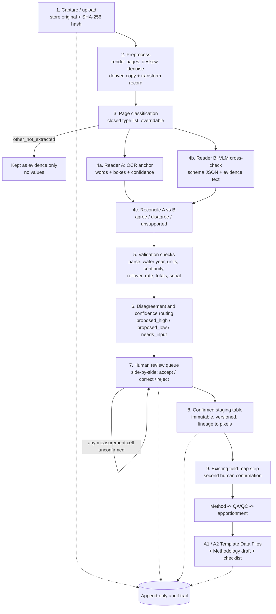

# CalWATRS Measurement Package: Document-Intake (OCR) Methodology

| Field | Value |
|---|---|
| Product | CalWATRS Measurement Package |
| Owner | Greg Durfee |
| Date | 2026-09-25 (America/Denver) |
| Phase | **Later.** The first slice stays CSV/Excel only. Nothing here starts until Greg moves document intake out of Later. |
| Status | Methodology for Cursor to follow when Greg introduces build prompts. This is not a prompt, not application code, and not a build authorization. |
| Inputs | `OCR_DOMAIN_INPUT.md` (Water Rights Domain), `OCR_PRODUCT_INPUT.md` (CalWATRS Product Analyst), `OCR_TECH_OPTIONS.md` (engine research), plus `docs/PRD.md`, `docs/FIRST_SLICE.md`, `docs/GLOSSARY.md`, `docs/BOARD_ACCEPTANCE_TARGET.md` |

**Terms used throughout.** CalWATRS is the California Water Accounting, Tracking, and Reporting System, the State Water Resources Control Board ("the Board") portal. A QI is a Qualified Individual under California Code of Regulations (CCR) title 23 §931. OCR is optical character recognition; in this document it means any method that turns an image or a PDF (Portable Document Format) file into text or a table, not one specific product. A VLM is a vision-language model, an artificial intelligence (AI) model that reads an image and answers in text or JSON (JavaScript Object Notation, a structured text format). A1 and A2 are the Board Template Data Files for Diversion to Direct Use and Diversion to Storage. CSV means comma-separated values. A bounding box ("bbox") is the rectangle on a page where a word or value sits. Other acronyms are expanded where they first appear. Board column names are used exactly as they appear in `docs/GLOSSARY.md`; this document adds no Board field IDs, device-type lists, or logger dialects.

---

## 1. Purpose and posture

This methodology describes how the CalWATRS Measurement Package will turn images, scans, and PDFs of text documents (meter-read logs, logger printouts, calibration certificates, and similar paperwork) into structured data that joins the existing CSV/Excel pipeline. Its value is efficient preprocessing: a consultant or QI should spend less time retyping paper records, while every number still passes through a human.

OCR is a **transcription accelerator, not a measurement source.** The Board's accuracy limits in Ch. 2.8 §933(i) (for example ±15% or ±10%, depending on device age and measurement frequency) are the error budget of the measuring device and its methodology. That budget is not an allowance for transcription. The transcription step must therefore add zero intentional error: **every accepted value must match what is written or printed on the source page, digit for digit, including the decimal point and any multiplier.** When the source is unreadable, the answer is an explicit gap, never a guess.

**The QI confirms.** Software proposes values and shows where they came from; a human (the QI, or staff working under a QI, which is still an open question) accepts, corrects, or rejects each one. The software never auto-certifies, never invents or smooths volumes, never scrapes or submits to the CalWATRS portal, and never gives legal opinions. Any correction a human makes is a quality assurance step under §931(q). It is recorded in the audit trail and can be described in the §934(a)(4) block of the Methodology draft; it is never hidden inside the value.

Three records stay separate forever: the original image, the text the machine read, and the value the human accepted. None of them overwrites another. Original files are kept unaltered with a content hash, on the assumption of the Board's 10-year raw-record retention rule (§935(c)).

---

## 2. Pipeline overview

Document intake is a **preprocessor, not a second pipeline.** Its only output is a confirmed staging table that looks, to the rest of the product, like a CSV/Excel ingest batch. From the field-map step onward, the batch follows the same path as a logger CSV. There is no OCR-specific method, exporter, or A1/A2 code path.



Each stage is described below by its inputs, outputs, method, and failure behavior. "Fail closed" means the item stops and waits for a human instead of moving forward. Every stage writes append-only audit events.

**Stage 1: Capture and upload.** *Inputs:* PDF (scanned or born-digital), PNG, JPEG, TIFF, or HEIC (High Efficiency Image Container) files, linked to a client and optionally to a claimed water right and measurement device. OCR-A is upload only; phone-camera capture arrives in OCR-B. *Outputs:* an immutable artifact record with the original bytes, a SHA-256 (Secure Hash Algorithm, 256-bit) hash, filename, uploader, upload time, and page count. Camera metadata (capture time, device time, GPS (Global Positioning System) location if present) is stored only as unverified hints. *Method:* hash on arrival and never modify the stored original. The original is a candidate for the Board's Original Data or Supplemental Files slot, and copy must never imply the scan is a Template Data File. *Failure:* unsupported or corrupt files are refused with a message; no in-app filter ever alters an original.

**Stage 2: Preprocessing.** *Inputs:* the original artifact. *Outputs:* one derived page image per page at a fixed resolution, plus a stored transform record (rotation, deskew angle, crop, perspective) so any box on the derived image maps back to the original. *Method:* rasterize PDFs with a permissively licensed renderer (the research names pypdfium2), then fix orientation, deskew, denoise, adjust contrast, and correct photo perspective (OpenCV, the deskew library, or PaddleOCR's orientation and unwarping tools). Record any engine image-quality score (Google Document AI reports blur, glare, and cutoff). *Failure:* a page too degraded to process is marked for human attention and still kept as evidence; a failed transform is logged, never hidden.

**Stage 3: Page classification.** *Inputs:* derived page images. *Outputs:* a proposed page type from a small closed list, a confidence, and a final type. *Method:* a cheap VLM call or a trained classifier. The OCR-A list is `meter_reading_log_typed`, `logger_printout_typed`, `calibration_or_verification_certificate`, `device_spec_or_nameplate`, and `other_not_extracted`; later phases add `meter_reading_log_handwritten`, `pump_energy_statement`, and `prior_report_or_statement`. The type decides which extraction schema, which checks, and which Board targets are allowed (Section 5). *Failure:* classification may be auto-accepted when confident, because a wrong type only changes which template is tried, is always visible and overridable, and never writes a value by itself. Low-confidence pages go to the reviewer. `other_not_extracted` pages are kept as evidence and produce no values. Reclassifying keeps the prior proposal in the log.

**Stage 4: Extraction by two independent readers.** *Inputs:* a classified page and its page-type schema (for a log row, the research's example is date, time, meter reading, reading unit, multiplier, device serial, reader initials, and an evidence object). *Outputs:* for every field or cell, a proposal from each reader plus a reconciliation result (agree, disagree, or unsupported by OCR, defined in Stage 6). *Method:* **Reader A, the OCR anchor,** returns raw text, per-word confidence, and word polygons, and finds table cells so each value knows its row (date and time) and column (reading and unit). **Reader B, the VLM cross-check,** returns JSON matching the schema plus the "evidence text" it relied on. Both run through the engine adapter (Section 6). Lineage always attaches to Reader A's word box, because VLM coordinates are approximate and are used only to locate a candidate. For meter-face photos (seven-segment or LCD (liquid crystal display) digits), crop the display and pair a VLM with a purpose-built digit reader such as ssocr, always showing the crop. *Failure:* if a reader errors or returns nothing, the cell has no agreement and cannot be `proposed_high`. Extracted numbers are **raw readings**, never Board rates or volumes, and nothing is written to a staging table yet. Re-runs keep prior proposals.

**Stage 5: Validation checks.** *Inputs:* reconciled proposals, the page type, the linked device record (serial, rated flow, register digit count, multiplier) when known, the selected water year, and neighboring rows and pages. *Outputs:* check results (pass, fail, or not applicable, with a message and neighboring values) on each cell and row. *Method:* the domain checks in Section 4, run regardless of engine confidence, because a value can be read confidently and still be wrong for the job. *Failure:* a failed check never changes a value; it flags the cell and row (both rows, for continuity checks) and forces individual review.

**Stage 6: Disagreement and confidence routing.** *Inputs:* reader agreement, Reader A confidence, and check results. *Outputs:* a review state per cell: `proposed_high`, `proposed_low`, or `needs_input`. *Method:* normalize both readings (strip spaces, unify decimal separators, apply units) and compare. An exact match on numbers and dates is **agree**; any digit difference is **disagree**, and the reviewer sees which characters differ; a VLM value with no matching OCR word nearby is **unsupported by OCR** (a possible hallucination). A cell is `proposed_high` only if the readers agree, Reader A's confidence meets the high threshold, and every check passes. Any weak signal gives `proposed_low`; a missing or unreadable required value gives `needs_input`. The research's starting thresholds (0.95 for high; below 0.80 as a strong red flag) are **starting points to tune on fixtures, not facts or Board rules**. *Failure:* uncertainty always routes to more review. An optional third tie-breaker reader may be tried on disputed cells, but it cannot confirm a value.

**Stage 7: Human review queue.** *Inputs:* proposals with states and check messages. *Outputs:* a final state per cell (`accepted`, `corrected`, or `rejected`) with reviewer, role, timestamp, and, for corrections, before and after values and a reason. *Method:* one screen with three panes. The **source pane** highlights the current cell's region on the page (zoom, pan, and all regions color-coded by state). The **table pane** is keyboard-first (arrows move focus and the source pane follows, Enter accepts, typing corrects, a reject key marks unreadable) and shows both readers' text for disputed cells. The **checks pane** lists fired checks with neighboring values. Reviewers can also add or delete rows for merged or split rows, reclassify a page, or re-run extraction; gated bulk accept is in Section 4.3. *Failure:* an unreadable cell becomes an explicit gap, or the reviewer requests the paper original. Nothing is guessed.

**Stage 8: Confirmed staging table.** *Inputs:* a document whose pages are all classified and whose measurement cells are all `accepted`, `corrected`, or `rejected`. *Outputs:* an immutable, versioned ingest batch with `source_kind = document_extract`, per-cell lineage, and explicit gap records (Section 3.2). *Method:* "Send to mapping" is enabled only when those conditions hold. Later fixes create a new review revision and a new batch version; old versions are never edited. *Failure:* a staging table with **any** unconfirmed measurement cell cannot reach the field-map step. This is the enforcement point for "never silently fill rate or volume," and an automated test must prove it.

**Stage 9: Handoff to the existing field-map step, then method, A1/A2, and audit.** *Inputs:* the confirmed staging batch. *Outputs:* the same raw series, method runs, QA/QC results, apportionment, and A1/A2 exports the CSV path produces. *Method:* the user maps staging columns to timestamp, raw reading, and unit and links a device, exactly as for CSV. This is a second, separate confirmation: the first says "the value was read correctly," the second says "this column means what I think it means." Only the documented method (totalizer, stage-storage curve, or pump runtime) produces `FLOW_RATE`, `VOLUME_DIVERTED_TO_USE`, or `VOLUME_DIVERTED_TO_STORAGE`. When a document-derived batch contributes to a right, the Methodology draft gains a short factual paragraph (which documents were transcribed, that values were human-reviewed, where originals are kept), worded with Water Rights Domain. *Failure:* all existing rules apply unchanged: no negatives, allowed Board unit strings only, zero-fill only after logged confirmation, and export blocked when lineage is incomplete. For any exported rate or volume cell, the audit export must show the document, page, region, what each reader read, what the human confirmed, and the formula that produced the Board value.

---

## 3. Data contracts

The product owns one engine-agnostic extraction result schema. Each engine adapter translates its vendor's output into this shape, so switching engines is a benchmark run rather than a rewrite. **Both JSON examples below are illustrative only.** Field names are product-side placeholders, not Board field IDs, and all identities are fictional fixtures from `FIRST_SLICE.md`.

### 3.1 Extraction result (one per proposed cell) — ILLUSTRATIVE

```json
{
  "_note": "ILLUSTRATIVE ONLY - not a final schema, not Board field IDs",
  "schema_version": "extraction-result/illustrative",
  "extraction_id": "ext-000123",
  "artifact": {
    "artifact_id": "art-0007",
    "sha256": "<hash of original file>",
    "original_filename": "north-ditch-reads-2026.pdf",
    "page_number": 2,
    "derived_image_id": "img-0007-p2",
    "transform_id": "tx-0007-p2"
  },
  "page_class": { "proposed": "meter_reading_log_typed", "confidence": 0.97,
                  "final": "meter_reading_log_typed", "overridden_by": null },
  "field": { "name": "raw_reading_value", "row_index": 4, "column_label_as_printed": "Reading" },
  "readers": [
    { "reader": "A", "role": "ocr_anchor", "engine": "<engine id>", "engine_version": "<pinned model id>",
      "raw_text": "0048213", "confidence": 0.98,
      "bbox_processed_px": [812, 1140, 948, 1172], "bbox_original_px": [806, 1151, 942, 1183],
      "word_ids": ["w-5521"] },
    { "reader": "B", "role": "vlm_cross_check", "engine": "<model id>", "engine_version": "<pinned model id>",
      "prompt_schema_version": "log-row/v1", "raw_text": "0048213",
      "evidence_text": "row 5, Reading column", "confidence": null, "bbox_hint": [80, 76, 95, 78] }
  ],
  "normalized_proposal": { "value": "0048213", "unit_as_printed": "gal", "multiplier_as_printed": null },
  "reader_agreement": { "status": "agree", "differing_characters": [], "supported_by_ocr": true },
  "checks": [
    { "check": "parse_number", "result": "pass" },
    { "check": "totalizer_continuity", "result": "pass", "neighbors": ["0047960", "0048455"] },
    { "check": "implied_rate_plausibility", "result": "not_applicable", "detail": "no rated flow on device record" }
  ],
  "review_state": "proposed_high",
  "reviewer_decision": { "action": "accepted", "final_value": "0048213", "reviewer": "<user id>",
                         "role": "QI", "correction_reason": null, "bulk_event_id": null },
  "timestamps": { "extracted_at": "2026-12-02T09:14:05-07:00", "decided_at": "2026-12-02T09:31:40-07:00" }
}
```

The reader confidence is `null` for the VLM because no VLM vendor documents a calibrated per-field confidence. The accepted value is stored as the exact characters confirmed (including leading zeros); numeric parsing happens downstream.

### 3.2 Confirmed staging table (one per reviewed document revision) — ILLUSTRATIVE

```json
{
  "_note": "ILLUSTRATIVE ONLY - product-side staging shape, not a Board template",
  "batch_id": "stg-0042", "batch_version": 1, "source_kind": "document_extract",
  "source_artifacts": [{ "artifact_id": "art-0007", "sha256": "<hash>" }],
  "linked_client": "Sample Irrigation Client", "linked_device_hint": "M0SAMPLE1 (fixture, not a real Board id)",
  "columns": ["reading_date", "reading_time", "raw_reading_value", "reading_unit_as_printed",
              "reading_type", "device_identifier_as_printed"],
  "rows": [
    { "row_id": "r5", "source_page": 2,
      "cells": {
        "reading_date":        { "value": "2026-04-07", "state": "accepted", "extraction_id": "ext-000121",
                                 "as_read": "4/7/26", "flag": "AMBIGUOUS_DATE_CONFIRMED" },
        "reading_time":        { "value": null, "state": "rejected", "extraction_id": "ext-000122",
                                 "flag": "TIME_MISSING" },
        "raw_reading_value":   { "value": "0048213", "state": "accepted", "extraction_id": "ext-000123" },
        "reading_unit_as_printed": { "value": "gal", "state": "accepted", "extraction_id": "ext-000124" }
      } }
  ],
  "gaps": [
    { "gap_id": "g1", "kind": "missing_visit", "start": "2026-05-01", "end": "2026-05-15",
      "basis": "no row on source page 3", "confirmed_by": "<user id>" }
  ],
  "cell_counts_by_state": { "accepted": 118, "corrected": 6, "rejected": 2 },
  "created_by": "<user id>", "created_at": "2026-12-02T10:02:11-07:00",
  "immutable": true, "supersedes": null
}
```

Rules for this table: it contains only raw readings and descriptors, never Board rates or volumes. A rejected cell has a null value and carries a gap or flag; it is never filled. A missing visit is a gap record with a start and end, not an invented row. Units are carried as printed and confirmed; conversion to `GALLONS`, `ACRE-FEET`, `CUBIC FEET PER SECOND`, or `GALLONS PER MINUTE` happens only in the documented method downstream.

---

## 4. Validation and routing rules

### 4.1 Checks

These checks are product rules drawn from the domain and product briefs. They are not Board rules, and any numeric thresholds are configurable with no default claimed as a Board requirement.

| Check | What it tests | On failure |
|---|---|---|
| Parse | Date is a real date; time parses; number has no stray characters | `proposed_low` or `needs_input` |
| Date format and ambiguity | Handwritten US dates such as `3/4/26` (day-month order), two-digit years, and missing years on continuation pages | Always require explicit confirmation; normalize to `YYYY-MM-DD` only after it |
| Time | Time present and parseable; output later becomes `hh:mm:ss` or `hh:mm:ss -n` | If no time was written, mark **TIME MISSING**; never invent one; the QI decides and a convention, if used, is logged and described in the methodology |
| Water-year boundary | Date falls inside the selected water year (October 1 to September 30) and rows are in order | Flag. A reading on October 1 closes one water year and opens the next, so both years need it |
| Daylight saving time and clock hints | Duplicate or skipped hour on logger printouts; photo EXIF (Exchangeable Image File Format) time | Preserve any source offset; treat EXIF and capture time as hints only |
| Units and multiplier | A unit is present on the page or column header and can be converted to an allowed Board string; a dial multiplier ("×10," "×100," "×1000") is captured and confirmed **per device, not per page** | Missing unit or multiplier **blocks** the value; never assume. Units such as "cfs," "sec-ft," miner's inches, MGD (million gallons per day), or "AF" are converted by a documented formula, never relabeled. Feet, elevation, pump hours, and kWh (kilowatt-hours) are not volumes |
| Decimal point | Faint or missing decimal on LCD photos | Require confirmation against prior and next readings (a misread decimal is a factor-of-10 error) |
| Partial wheel digit | Mechanical register with a half-rolled last digit | Record the lower digit and flag, or flag as ambiguous; never round up |
| Totalizer continuity | Cumulative readings do not decrease | Flag both rows. Never "fix" silently |
| Rollover | A decrease consistent with an N-digit register wrapping at 10^N (for example `9,999,999` to `0,000,120`) | Propose a rollover interpretation using the register's digit count; require confirmation |
| Replacement, reset, or repair | New device or restart at zero or another start value | Differencing across the event is blocked until an S13 record (old final reading, new start reading, time) or a human-entered event exists; the new device needs its own registry record and evidence |
| Backflow or reverse registration | A decrease with no rollover explanation | Flag; never report a negative volume; QI decides |
| Transposed digits | For example `48213` read as `48123`, detected by monotonicity against neighbors | Flag for review |
| Implied-rate plausibility | Rate implied by consecutive readings over the interval, compared with device rated flow or right capacity when known | Flag when far outside; **never auto-cap** |
| Page totals | If the page prints a total, the extracted rows are summed and compared | Flag the page |
| Cross-page continuity | Last reading on page N versus first reading on page N+1 | Flag both |
| Serial or identity match | Meter or serial printed on the page matches the linked device | Flag; the reviewer confirms the link |
| Billing-period frequency | Electricity bills cover billing periods, not reading times (OCR-C) | Surface as a frequency issue; never split kWh evenly across days |

### 4.2 What forces individual review

A cell must be handled one by one when any of the following is true: the readers disagree; the VLM value is unsupported by OCR; Reader A's confidence is below the high threshold; any check on the cell or its row failed; the value is missing, illegible, or `needs_input`; the cell is a handwritten reading (OCR-B, always); the cell comes from a meter-face photo (always); the cell is a method parameter such as a pulse factor or rated flow (always, and the method screen shows its source); or the date is ambiguous. Low confidence on a legible value only changes review order; the confirmation required is the same as for any value.

### 4.3 Gated bulk accept

Raw readings that will feed a rate or volume (the reading value, its unit, reading type, and date and time) are **never auto-accepted**. Every cell ends in an explicit human state. Bulk accept is a faster way to record that human state, and it is allowed only when **all** of these conditions hold:

1. The document type has passed its bulk-accept gate: **zero silent errors on the gating fixture set** (Section 7). Until then, that type is one-by-one only.
2. The cells are `proposed_high` (readers agree, confidence high, all checks pass).
3. The action covers one page at a time.
4. The reviewer has had every row on that page on screen; the product tracks scroll-through.
5. No cell in a row that failed any check is included.
6. The cells are not handwritten readings, meter-face photo values, or method parameters.

Non-measurement metadata marked `proposed_high` (for example device make and model on a certificate) still needs a human accept, but it may be bulk accepted per page. Each bulk accept is logged as one event that lists every cell it covered, so traceability stays cell by cell.

### 4.4 Rejected means an explicit gap

A rejected or unreadable cell becomes an explicit gap in the staging table. It is never guessed, interpolated, or smoothed. A differenced interval that spans a gap is reported only as the reading-to-reading interval the source supports, with the gap flagged. Whether that meets the required frequency is a QI judgment and possibly a Board notification matter (§933(i)(2) requires notice within 30 days if data do not, or are unlikely to, meet accuracy requirements). Zero-fill happens only after an explicit, logged user confirmation that no water was diverted (PRD hard rule 8).

---

## 5. Source-document catalog and target map

The prevalence of each source type is a hypothesis for consultant interviews, not a market fact. "QI-gated" means a value can reach a rate or volume cell only after logged QI (or QI-supervised) confirmation **and** only through the documented method. "Page class" shows which classification label covers the source today; a dash means no brief assigns one yet.

| # | Source | Typical form | Allowed targets | Rate/volume? | Page class and phase |
|---|---|---|---|---|---|
| S1 | Manual meter-read log (totalizer readings) | Mostly handwritten | Raw readings to staging, then method (differencing, derived rate); DATE/TIME; Original Data; §934(a)(4), (5), (9) | QI-gated via method | `meter_reading_log_typed` (OCR-A); `meter_reading_log_handwritten` (OCR-B) |
| S2 | Handwritten field sheet (mixed notes) | Handwritten, free-form | Only actual device readings, if present; notes feed QA notes and gap explanations | QI-gated; **notes never become numbers** | — (not assigned) |
| S3 | Logger printout or printed PDF | Typed table | Readings to staging; DATE/TIME; Original Data; §934(a)(5), (6), (9); serial cross-check | QI-gated via method. Ask for the native CSV first; OCR is the fallback | `logger_printout_typed` (OCR-A) |
| S4 | Totalizer or register photo | Machine-displayed digits | Check points and spot audits; Supplemental Files; §934(d) evidence | QI-gated; one photo alone does not satisfy frequency; photo time is a hint | — (evidence plus suggested value only) |
| S5 | Staff-gage or reservoir level photo or log | Photo or handwritten | Only through a stage-storage or rating conversion; §934(a)(5)(D), (7) | QI-gated, **never as a raw feet value** | — |
| S6 | Calibration, verification, or field-test report | Typed, signed | Device registry (accuracy, test dates, verifier); Supplemental Files; §934(a)(4); §934(d)(1) | **Never** | `calibration_or_verification_certificate` (OCR-A) |
| S7 | Laboratory certification | Typed | Registry and §934(d)(1) evidence; Supplemental Files | **Never** | `calibration_or_verification_certificate` (OCR-A) |
| S8 | Device install or commissioning record | Typed or handwritten | Registry (make/model, POD, install date, installer QI contact); §934(a)(3) | **Never** | Closest is `device_spec_or_nameplate` (OCR-A) |
| S9 | Prior-year reports and filings | Typed | Editable starting text for §934(a)(1)–(3), (8); registry hints that a human re-confirms | **Never**; never labeled certified | `prior_report_or_statement` (OCR-C) |
| S10 | Electricity bills and pump-test reports | Typed | Only through a documented, QI-approved conversion; §934(a)(5)(D), (9) | QI-gated via conversion; billing-period frequency issue | `pump_energy_statement` (OCR-C) |
| S11 | Pump runtime or hour-meter log | Usually handwritten | Only through runtime × rated flow; §934(a)(5)(D) | QI-gated via method | — |
| S12 | Rating table or stage-discharge/stage-storage curve | Typed, sometimes annotated | Conversion parameter only; Supplemental Files; §934(a)(5) | **Never directly** | — |
| S13 | Meter replacement or repair record | Typed or handwritten | Controls how S1/S3 readings are differenced; new device registry record; §934(a)(4), (9) | **Never directly** | — |

Guardrails from this table: S6–S9 and S12 must never populate a rate or volume cell, even after confirmation; the product enforces this by page class, not only by reviewer care. Every formula that transforms a value (S1 differencing, S5, S10, S11) must be documented and approved by a QI. Registry fields extracted from S6–S8 remain free text; the product invents no device-type values.

---

## 6. Engine strategy

**Posture on vendor choice.** The product brief asks that product documents not lock in an engine, and the research recommends one. This methodology resolves that by treating the research recommendation as the **default to validate in a bake-off**, behind an adapter that keeps every engine swappable. Nothing below is final until the bake-off on real, consented pages confirms it.

**Default (to be confirmed): Azure AI Document Intelligence (Read or Layout, v4.0) as Reader A plus a vision LLM (large language model) as Reader B.** Azure returns per-word confidence and polygons and flags handwritten lines ([Read model](https://learn.microsoft.com/en-us/azure/ai-services/document-intelligence/prebuilt/read)). It keeps inputs and results for 24 hours and then deletes them, and they can be deleted sooner through an API (application programming interface) call ([data privacy](https://learn.microsoft.com/en-us/azure/ai-foundry/responsible-ai/document-intelligence/data-privacy-security)). Read and Layout also run in containers on your own hardware, with an offline mode that needs Microsoft approval and a commitment plan ([containers](https://learn.microsoft.com/en-us/azure/ai-services/document-intelligence/containers/install-run?view=doc-intel-4.0.0), [disconnected](https://learn.microsoft.com/en-us/azure/ai-services/containers/disconnected-containers)). Reader B is a model such as Claude Sonnet or a Gemini Flash-class model using structured JSON output. VLMs have no native per-field confidence and can hallucinate on poor images ([Claude vision](https://platform.claude.com/docs/en/build-with-claude/vision)), so the VLM is never the only source of a number.

**Fallback: fully self-hosted open source.** PaddleOCR 3.x (PP-OCRv5 / PP-StructureV3, Apache-2.0) as Reader A, which returns per-line `rec_scores` and polygons ([PaddleOCR docs](https://raw.githubusercontent.com/PaddlePaddle/PaddleOCR/main/docs/version3.x/pipeline_usage/OCR.en.md)), paired with a locally run Qwen3-VL (Apache-2.0) as Reader B ([Qwen3-VL](https://github.com/QwenLM/Qwen3-VL)). This becomes the primary path if a client forbids cloud processing, if offline work is a real requirement, or if per-page cloud cost becomes a problem. The cost moves to GPU (graphics processing unit) hosting and engineering effort.

**Bake-off candidates.** Mistral OCR 4 (released 2026-06-23) returns bounding boxes and page-, block-, or word-level confidence, costs $4 per 1,000 pages ($2 batch), and can be self-hosted by enterprise customers ([Mistral OCR 4](https://mistral.ai/news/ocr-4/), [docs](https://docs.mistral.ai/capabilities/document_ai/basic_ocr)). Its accuracy claims are the vendor's own. The research also profiles AWS Textract and Google Document AI as viable managed alternatives. Tesseract is unsuitable for handwriting per its own FAQ (frequently asked questions) ([FAQ](https://tesseract-ocr.github.io/tessdoc/FAQ.html)). **Meter-face photos** are a special case: no general engine documents seven-segment accuracy, and a 2024 survey found off-the-shelf recognizers peaked at 56.97% on one seven-segment dataset while custom-trained models reached roughly 93–97% ([VFAST survey](https://vfast.org/journals/index.php/VTSE/article/download/1923/1605)). Treat them as "suggested reading, crop shown, QI types or confirms" until the harness proves otherwise.

**Adapter pattern and pinned versions.** Each engine sits behind one adapter interface: input is a page image; output is the extraction result shape in Section 3.1 (value, raw text, bbox, confidence). The product and the bake-off use the same adapter and harness. Every run records the engine name, pinned model version, prompt and schema version, and parameters in the lineage record. Pin versions where vendors allow it (Google lets you freeze an OCR model version for up to 18 months ([Enterprise OCR](https://cloud.google.com/document-ai/docs/enterprise-document-ocr))), and re-run the harness on every model or prompt change. Cache vendor responses keyed by file hash, engine, and model version so runs are cheap and repeatable.

**Costs.** List prices below were read by the research on 2026-09-24/25 and change often; re-check before committing. Items marked *estimate* are the researcher's estimates, not vendor statements.

| Item | Cost |
|---|---|
| Azure Read | $1.50 per 1,000 pages ($0.60 after 1 million); 500 free pages per month on the F0 tier ([retail price API](https://prices.azure.com/api/retail/prices?$filter=contains(productName,%27Document%20Intelligence%27))) |
| Azure Layout / prebuilt | $10 per 1,000 pages ($0.010 per page) |
| Mistral OCR 4 | $4 per 1,000 pages; $2 batch; $5 per 1,000 annotated pages |
| AWS Textract | Detect Text $0.0015/page; Tables+Forms+Queries $0.07/page ([pricing](https://aws.amazon.com/textract/pricing/)) |
| Google Document AI | OCR $1.50 per 1,000; Form Parser $30 per 1,000; Layout Parser $10 per 1,000 ([pricing](https://cloud.google.com/document-ai/pricing)) |
| Claude Sonnet 5 as Reader B | ≈ $0.015 per page (*estimate*, one ~2000×1500 px page) ([pricing](https://platform.claude.com/docs/en/about-claude/pricing)) |
| Gemini 3.5 Flash-Lite as Reader B | ≈ $0.002 per page (*rough estimate*) ([pricing](https://ai.google.dev/gemini-api/docs/pricing)) |
| Hybrid default total | ≈ $0.012–$0.025 per page before retries and human review time (*estimate*); human review time is expected to dominate |

**Privacy notes carried from the research.** Textract may use inputs to improve Amazon AI unless you opt out through an AWS Organizations policy ([FAQ](https://aws.amazon.com/textract/faqs/)). The Gemini free tier uses content to improve Google products, so client documents must never go to a free tier. Anthropic states it does not train on uploaded images, and US-only inference costs 1.1×. OpenAI API data is not used for training unless you opt in, with abuse logs kept up to 30 days ([your data](https://developers.openai.com/api/docs/guides/your-data)).

---

## 7. Accuracy measurement

**Fixtures with ground truth.** Build synthetic fixtures first: generate typed meter-reading logs and certificate-style pages from known values, reusing fictional identities such as `SAMPLE-WR-001` and `M0SAMPLE1`, render them to PDF and image, and derive degraded variants (skew, low resolution, JPEG artifacts, shadows, partial crop, fax-style noise, perspective). Each page has a ground-truth JSON file with the page type and, for every field or cell, its name, row index, expected value, expected unit, and expected bounding box. Then add 100–300 real pages, anonymized and used only with client or design-partner consent, labeled by a human (the research names Label Studio). Keep a **held-out gating set** that is never used for prompt tuning. Handwritten fixtures (OCR-B) must be human-written samples; synthetic fonts alone are not enough.

**Synthetic edge cases, on purpose:** totalizer rollover sequences (…99998, 99999, 00000, 00001), mid-season meter replacement, a decreasing reading, a missing unit header, mixed units across pages, a missing multiplier, a page total, blank rows, a date outside the water year, an October 1 reading, `3/4/26`, a missing time, a daylight saving time shift, a decimal misread, transposed digits, and a serial that does not match the linked device. For meter faces, the research suggests the DSEG seven-segment font over photo backgrounds.

**Metrics.**

| Metric | Definition | Use |
|---|---|---|
| Field exact match | Share of numeric and date fields equal to ground truth after normalization, by field type | The metric that matters for volumes |
| Character error rate (CER) | Edits needed divided by characters, for free text and near-miss diagnosis (jiwer computes it) | Diagnosis |
| Field precision and recall; box IoU | Whether the right fields were found; intersection over union between predicted and labeled boxes | Lineage quality |
| Classification accuracy | Correct page type on first proposal | Harness |
| Flag recall (catch rate) | Share of wrong values that were flagged (`proposed_low` or `needs_input`); should be close to 100% | Routing quality |
| **Silent error rate** | Share of `proposed_high` cells that were wrong against ground truth (fixtures) or later corrected downstream (pilots) | **The safety metric;** decides whether bulk accept exists for a document type |
| Forced-review share | Share of cells routed to individual review | Workload; too high erases savings |
| Correction rate | Share of measurement cells the reviewer corrected, by document type | Shows where extraction is weak |
| Post-handoff reopen rate | Share of confirmed batches revised later | Signals missed errors in review |
| Minutes per right (document portion) | Wall time from upload to confirmed staging table, per right, versus the same consultant's manual retyping baseline | Primary value metric; baseline must be measured in a pilot, not assumed |
| Cost and latency per page | Engine spend and time | Engine choice |

**Harness.** A command-line script plus a continuous-integration job runs every engine configuration, plus the product checks, over the fixtures. It writes a machine-readable scorecard and a short summary broken down by document type and degradation level, so accuracy is tracked per commit and per engine. It fails the build if field exact match or flag recall drops below the last accepted baseline. A separate end-to-end test proves the safety rule: a staging table with any unconfirmed measurement cell cannot reach the field-map step, and no export contains a document-derived value without an accept event. An automated lineage check proves every exported rate or volume cell traces to image, region, OCR text, accepted value, confirmer, and formula.

**Gates before any bulk or automatic behavior.** Do not hard-code accuracy targets before a baseline exists. First run the harness on synthetic fixtures, then on the real gating set; then Greg and the General Manager set gates per document type. The minimum gate shape is: **bulk accept for a document type is enabled only if its silent error rate on the gating set is zero;** otherwise that type is one-by-one only. The research suggests at least 99% of errors flagged as the bar before handwriting ingestion ships; that is a shipping bar, not permission for bulk accept. No gate ever permits auto-acceptance of measurement cells. Downstream, 100% of exported values must equal the human-confirmed source reading, verified by blind double entry or independent re-read on a labeled test set.

---

## 8. Phasing

The ordering rule is highest consultant time savings with lowest risk to rate and volume cells first. Time savings remain a hypothesis until measured in pilots.

**OCR-A (MVP of the OCR phase).** Calibration and verification certificates and device spec sheets first (they feed the device registry and QA content due January 31, 2027 and never produce rate or volume), then typed or printed meter-reading logs and logger printouts. Scope: upload only, one document at a time with multiple pages, the five-type classification list, two readers, side-by-side review, per-cell and gated bulk accept, handoff into the unchanged field-map step, full audit, English only.
*Done when:* (1) a consultant uploads a typed meter-reading log PDF, reviews it side by side, and produces a confirmed staging table that flows through the unchanged field-map, method, and A1 export path; (2) no rate or volume value appears in any export unless every raw reading feeding it has an `accepted` or `corrected` event, and an automated test proves an unconfirmed cell blocks handoff; (3) every document-derived exported cell traces to file, page, and bounding box; (4) a calibration certificate populates registry fields only after acceptance, with lineage; (5) originals are retained unmodified with hashes; (6) fixture accuracy meets the gates agreed after baselining, with no silent errors on the gating set; (7) copy says values were extracted for review and never says they were verified, certified, or accurate.

**OCR-B.** Handwritten meter-reading logs (every reading one by one; no bulk accept for handwritten readings), phone-camera capture with capture metadata, and multi-document batches per client aligned with January batch work (PRD M7). Meter-face photos, if included, are evidence plus a suggested value only. Starts only after a pilot readout on OCR-A metrics.
*Done when:* handwritten fixtures built from real human-written samples meet the agreed flag-recall bar; zero handwritten readings can be bulk accepted (tested); camera captures write the same artifact record as upload with metadata stored as hints and originals untouched; a season of paperwork for one client can be queued and reviewed with lineage intact; and the OCR-A done-when items still pass.

**OCR-C (each item needs a separate go).** Pump energy statements (for the pump runtime method, whose energy curve is already Later in the PRD); prior-year reports as reference text only, never as new measurement values; chart recorders and strip charts are parked, likely permanently, because they require digitizing a curve rather than reading text.
*Done when (per item):* Greg gives an explicit go; the page class and schema exist with fixtures; energy data can reach a volume only through a documented, QI-approved conversion and billing periods surface as a frequency issue; prior-report text lands only as editable Methodology draft text that is never labeled certified; and the safety and lineage tests pass.

---

## 9. Build slices for Cursor

Each slice stops for Greg's review, like the first slice. These are descriptions of work, not prompts.

**Setup before slice 1: project guardrails.** Add Cursor Project Rules stating that extracted values never reach A1/A2 without a review-decision record, that every extracted value carries an evidence object, and that no AGPL dependency is added without asking. Add a hook that blocks sending anything under a real-fixtures folder to external tools.

1. **Harness and fixtures, no user interface.** Build the synthetic fixture generator and ground-truth JSON, the engine adapter interface with a stub engine and at least one candidate engine, reconciliation of two readers, and the metrics scorecard.
2. **Upload and classification.** Store originals immutably with hashes, render and preprocess pages into derived images with stored transforms, and classify pages with manual override. Extraction results are saved as proposals only.
3. **Review screen.** Build the three-pane side-by-side screen with per-cell accept, correct, and reject, add and delete row, reclassify, and re-run, with an audit event for every action.
4. **Handoff into the existing field-map step.** Create the confirmed staging table as an immutable, versioned ingest batch, block handoff on any unconfirmed cell, and add an end-to-end test from a typed log PDF to an A1 export with full lineage.
5. **Checks and gated bulk accept.** Wire the Section 4 checks into review states, and add bulk accept with scroll-through tracking, per-page limits, and the per-document-type silent-error gate.
6. **Certificates and spec sheets into the device registry and method parameters,** with lineage shown on the registry and method screens and individual accept for every method parameter.
7. **Methodology draft paragraph** for document-derived batches, with wording confirmed by Water Rights Domain.
8. **OCR-B items** (handwritten logs, camera capture, batches) only after a pilot readout on OCR-A metrics.

**Tooling verified to exist by the research on 2026-09-25.**

| Kind | Item | Link | License or caution |
|---|---|---|---|
| Cursor feature | MCP (Model Context Protocol) servers in `mcp.json` | [docs](https://cursor.com/docs/context/mcp) | Use synthetic or anonymized fixtures only in agent sessions |
| Cursor feature | Project Rules (`.cursor/rules`) | [docs](https://cursor.com/docs/context/rules) | — |
| Cursor feature | Agent Skills (`.cursor/skills/`) | [docs](https://cursor.com/docs/context/skills) | Suggested: "run OCR harness and summarize scorecard" |
| Cursor feature | Hooks (`hooks.json`) | [docs](https://cursor.com/docs/agent/hooks) | Can block MCP calls |
| MCP | Playwright MCP (review-screen testing) | [repo](https://github.com/microsoft/playwright-mcp) | — |
| MCP | PaddleOCR MCP server | [docs](https://raw.githubusercontent.com/PaddlePaddle/PaddleOCR/main/docs/version3.x/integrations/mcp_server.en.md) | — |
| MCP | Docling MCP | [repo](https://github.com/docling-project/docling-mcp) | Docling is MIT |
| MCP | MarkItDown MCP | [repo](https://github.com/microsoft/markitdown/tree/main/packages/markitdown-mcp) | — |
| MCP | AWS Document Loader MCP | [repo](https://github.com/awslabs/mcp/tree/main/src/document-loader-mcp-server) | Confined to a base directory |
| Library | pypdfium2 (PDF rendering) | [repo](https://github.com/pypdfium2-team/pypdfium2) | Permissive; preferred |
| Library | PyMuPDF | [repo](https://github.com/pymupdf/PyMuPDF) | **AGPL-3.0** (GNU Affero General Public License): may require publishing source for a hosted service unless a commercial license is bought |
| Library | OpenCV, deskew | [opencv-python](https://github.com/opencv/opencv-python), [deskew](https://github.com/sbrunner/deskew) | — |
| Library | OCRmyPDF | [repo](https://github.com/ocrmypdf/OCRmyPDF) | MPL-2.0 |
| Library | Pydantic, jsonschema | [pydantic](https://github.com/pydantic/pydantic), [jsonschema](https://github.com/python-jsonschema/jsonschema) | — |
| Library | jiwer (CER) | [repo](https://github.com/jitsi/jiwer) | — |
| Library | Label Studio (labeling) | [repo](https://github.com/HumanSignal/label-studio) | Apache-2.0, self-hostable |
| Library | TRDG, SynthTIGER, DSEG font | [TRDG](https://github.com/Belval/TextRecognitionDataGenerator), [SynthTIGER](https://github.com/clovaai/synthtiger), [DSEG](https://github.com/keshikan/DSEG) | DSEG is OFL-1.1 |
| Library | AlbumentationsX | [repo](https://github.com/albumentations-team/AlbumentationsX) | **AGPL-3.0**; original Albumentations is archived |
| Library | ssocr (seven-segment) | [repo](https://github.com/auerswal/ssocr) | Needs consistent cropped input |
| Library | Mistral Python client; Azure, AWS, Google SDKs | [Mistral client](https://github.com/mistralai/client-python) | — |
| Model | Surya, Chandra | [Surya](https://github.com/datalab-to/surya), [Chandra](https://github.com/datalab-to/chandra) | **Weight licenses** (modified OpenRAIL-M) cap use by funding/revenue ($5M Surya, $2M Chandra), and Chandra "cannot be used competitively with our API." License review required |
| Model | MinerU | [repo](https://github.com/opendatalab/MinerU) | License shows "NOASSERTION"; check before use |

---

## 10. Open decisions for Greg

Recommendations are given only where the briefs support one.

**10.1 Business and pricing**
1. *How to charge for per-page engine cost (pass-through, bundled, or page caps per plan).* No recommendation in the briefs; decide after pilot cost data, noting that review time, not engine cost, is expected to dominate.
2. *Acceptable review time per page before the feature stops saving time.* Recommendation: measure the manual retyping baseline in a pilot before setting it.

**10.2 Privacy**
3. *Can client scans go to a hosted engine at all, and which vendors appear in client terms and the privacy notice?* Recommendation: favor vendors with no-training and short-retention terms (Azure's 24-hour deletion) and never use free tiers.
4. *Is US-only processing or a signed data-processing agreement required?* No recommendation; confirm with clients (Claude US-only inference costs 1.1×).
5. *Is offline or on-premises processing a real requirement?* Recommendation: if yes, make PaddleOCR plus Qwen3-VL the primary path.
6. *Real documents in development sessions.* Recommendation: synthetic or anonymized fixtures only, enforced by a Cursor hook.

**10.3 Domain and Board**
7. *Must a QI personally perform the review, or can staff review with QI sign-off?* Recommendation: record reviewer role on every decision so either answer works; confirm with Water Rights Domain.
8. *Does the Board accept transcriptions as raw device output, and should the confirmed staging table be offered as Original Data or only the source scans?* Recommendation: retain both the scan and the transcription.
9. *What time convention is acceptable when a hand log has no recorded time?* Recommendation: mark TIME MISSING and let the QI record a convention in the methodology; ask Measurement staff.
10. *Can season start/end totalizer photos support anything beyond evidence?* Recommendation: treat them as evidence only unless Measurement staff say otherwise.
11. *Can billing-period electricity data meet weekly or monthly frequency?* No recommendation; confirm per right before OCR-C.
12. *Wording of the Methodology draft paragraph for document-derived batches.* Recommendation: Water Rights Domain confirms before slice 7.

**10.4 Product**
13. *Which document types consultants receive most, and is non-English paperwork needed?* Recommendation: validate in consultant interviews before reordering OCR-A; default English only.
14. *Page classes for S2, S4, S5, S11, S12, and S13, which no brief yet assigns.* Recommendation: keep them as stored evidence with no extraction until classes are defined; allow S13 events to be human-entered.
15. *Ship meter-face photos as evidence plus a suggested value only at first?* Recommendation: yes.

**10.5 Technical**
16. *Confirm or swap the default engine.* Recommendation: a one-week bake-off of Azure Layout, Mistral OCR 4, and PaddleOCR (each alone and with a VLM cross-check) on 30–50 anonymized real pages, scored on field exact match and flag recall.
17. *Accuracy gates per document type.* Recommendation: zero silent errors on the gating set for bulk accept; at least 99% of errors flagged before handwriting ships.
18. *Does extraction run as a Python service beside the web app?* No recommendation beyond noting that most tools are Python-first and the application stack is still undecided in the PRD.
19. *License review for AGPL libraries and restricted model weights.* Recommendation: use pypdfium2 and OpenCV; review before adding PyMuPDF, AlbumentationsX, Surya, Chandra, or MinerU.
20. *Reproducibility.* Recommendation: pin model versions, store the model ID in lineage, and re-run the harness on every upgrade.

**10.6 Conflicts between the briefs and how this document resolved them**
- *Bulk confirmation.* The research lets "green" values be bulk-confirmed on agreement plus 0.95 confidence plus passing rules. The product brief adds per-page scope, scroll-through, exclusion of rows with failed checks, no bulk for handwritten readings, and a zero-silent-error gate. This document uses the product rules plus the research's agreement requirement.
- *Definition of `proposed_high`.* The product brief requires engine confidence and passing checks; the research also requires reader agreement. This document requires all three.
- *Vendor choice.* The product brief says product documents should not pick an engine; the research recommends Azure plus a VLM. This document treats Azure as a default to confirm in a bake-off, behind a swappable adapter.
- *Correction reasons.* The product brief makes the correction reason optional; the domain brief says every correction needs a reason. This document requires a reason (a short pick list is enough).
- *Fixture strategy.* The product brief says synthetic first; the research says real pages are the core set and synthetic is a supplement. This document builds synthetic first but requires a real, held-out gating set before any gate is set, and real handwriting for OCR-B.
- *Handwriting bar.* The research suggests at least 99% of errors flagged before handwriting ships; the product brief makes zero silent errors the bulk-accept gate. Both apply, and handwritten readings are never bulk accepted regardless.
- *Class list coverage.* The research's classification list includes field sheets, meter-face photos, and install records; the product brief's closed list does not. This document uses the product list and leaves new classes as an open decision.

---

## 11. Sources

**Input briefs (all in `/workspace/briefs/`):** `OCR_DOMAIN_INPUT.md` (source catalog S1–S13, target map, evidence rules, traps, acceptance tests, Board citations to Ch. 2.8 §931, §933, §934, §935; Manual 5.2, 6.2, Table 6, A.1–A.4; FAQ; *Submitting Measurement Data in CalWATRS*; A1/A2 templates); `OCR_PRODUCT_INPUT.md` (single downstream path, review workflow and states, checks, bulk-accept rules, audit, phasing, metrics, slices); `OCR_TECH_OPTIONS.md` (engines, architecture, disagreement flagging, accuracy measurement, Cursor tooling, risks). **Consistency references:** `/workspace/calwatrs-cursor-handoff/docs/PRD.md`, `FIRST_SLICE.md`, `GLOSSARY.md`, `BOARD_ACCEPTANCE_TARGET.md`.

**Key URLs (from the research, read 2026-09-24/25; all others are cited inline in Sections 6 and 9):** [Azure Read model](https://learn.microsoft.com/en-us/azure/ai-services/document-intelligence/prebuilt/read) · [Azure data privacy](https://learn.microsoft.com/en-us/azure/ai-foundry/responsible-ai/document-intelligence/data-privacy-security) · [Azure containers](https://learn.microsoft.com/en-us/azure/ai-services/document-intelligence/containers/install-run?view=doc-intel-4.0.0) · [Azure disconnected containers](https://learn.microsoft.com/en-us/azure/ai-services/document-intelligence/containers/disconnected?view=doc-intel-4.0.0) · [Mistral OCR 4](https://mistral.ai/news/ocr-4/) · [PaddleOCR](https://github.com/PaddlePaddle/PaddleOCR) · [Qwen3-VL](https://github.com/QwenLM/Qwen3-VL) · [Claude vision](https://platform.claude.com/docs/en/build-with-claude/vision) · [Google Enterprise OCR](https://cloud.google.com/document-ai/docs/enterprise-document-ocr) · [AWS Textract FAQ](https://aws.amazon.com/textract/faqs/) · [Gemini pricing](https://ai.google.dev/gemini-api/docs/pricing) · [VFAST seven-segment survey](https://vfast.org/journals/index.php/VTSE/article/download/1923/1605) · [Cursor MCP docs](https://cursor.com/docs/context/mcp).

Prices, model names, and license terms change often. Re-check them before any commitment.
